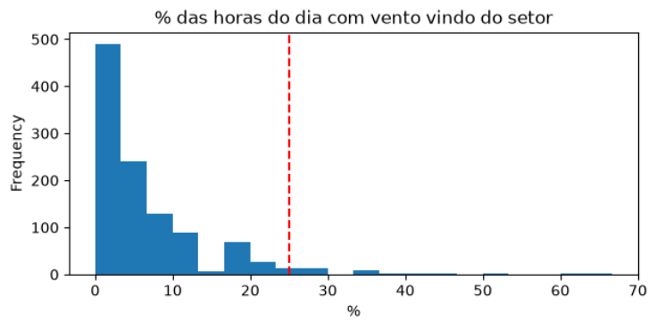
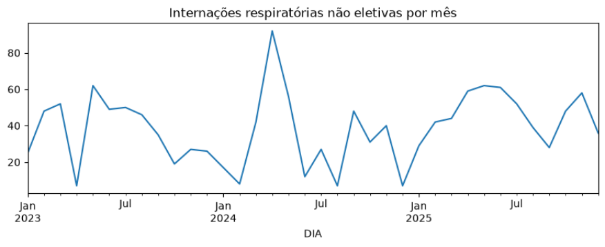
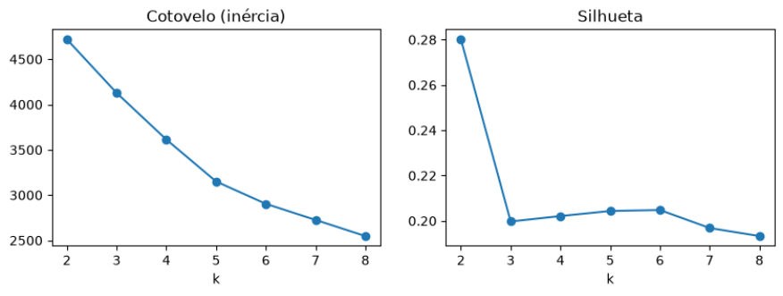
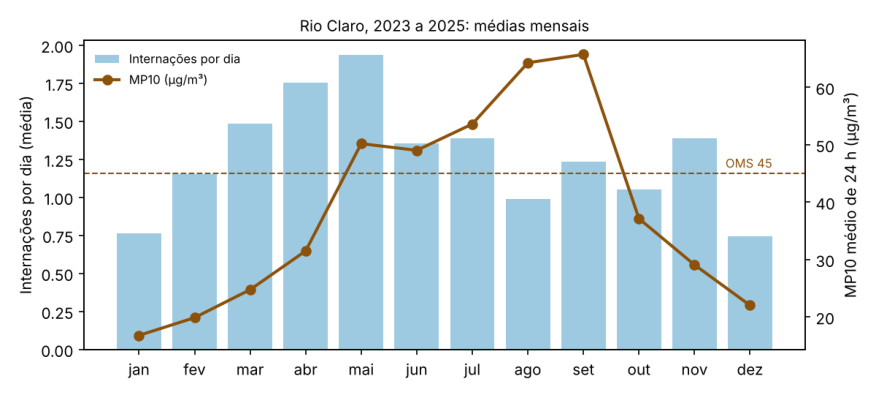

**CENTRO ESTADUAL DE EDUCAÇÃO TECNOLÓGICA PAULA SOUZA** 
**FACULDADE DE TECNOLOGIA DE RIO CLARO** 
**CURSO SUPERIOR DE TECNOLOGIA EM INTELIGÊNCIA ARTIFICIAL**

 

FERNANDO MANESCO 
MAURO SILVA RUIZ

 

# Análise de MP10, condições meteorológicas e internações respiratórias no Polo Cerâmico: aplicação de mineração de dados (K-means e Apriori)

Relatório de atividades apresentado à disciplina de Mineração de Dados 
Professora: Angela de Godoy

**RIO CLARO – SP · 2026**

---

## Arquivos do projeto

| Arquivo | Conteúdo |
|---|---|
| [Relatorio_MP10_Internacoes_Polo_Ceramico_final_27112016.pdf](Relatorio_MP10_Internacoes_Polo_Ceramico_final_27112016.pdf) | Relatório completo em PDF (30 páginas, com os anexos) |
| [poluicao_internacoes_rioclaro.ipynb](poluicao_internacoes_rioclaro.ipynb) | Notebook Python com todas as etapas, tabelas e gráficos |
| [cetesb_rio_claro_2023_2025_unificado.csv](cetesb_rio_claro_2023_2025_unificado.csv) | Dados horários da CETESB, estação Rio Claro – Jardim Guanabara, 2023 a 2025 |
| [sih_rioclaro_respiratorias.csv](sih_rioclaro_respiratorias.csv) | Internações respiratórias do SIH/SUS, residentes de Rio Claro |
| [Apresentacao_MP10_polo_ceramico_preliminar.pptx](Apresentacao_MP10_polo_ceramico_preliminar.pptx) | Apresentação do projeto |

Para reproduzir a análise, baixe o notebook e os dois arquivos CSV para a mesma pasta e execute os blocos em ordem.

---

## Resumo

O Polo Cerâmico de Santa Gertrudes registra os maiores níveis de MP10 do interior paulista. Este estudo aplicou K-means e Apriori a dados horários da CETESB, estação de Rio Claro, e a internações respiratórias não eletivas do SIH/SUS, CID-10 J00 a J99, de 2023 a 2025, para investigar a associação entre MP10 e internações. A média de 24 h do MP10 superou o limite da OMS em 350 de 1.088 dias, concentrados de maio a setembro. O K-means isolou um grupo seco e poluído, com MP10 médio de 67,5 µg/m³, cuja média de internações, de 1,34 por dia, foi praticamente igual à dos demais grupos. A regra Apriori de maior lift, de 1,55, combinou MP10 acima do limite e umidade alta, mas esses dias se concentram de maio a julho, no período de circulação viral, enquanto o pico de MP10 ocorre em agosto e setembro, quando as internações caem. A premissa de associação não foi confirmada no polo cerâmico.

**Palavras-chave:** Material Particulado; Mineração de Dados; Internações Hospitalares; Doenças Respiratórias; Polo Cerâmico.

## Abstract

The Santa Gertrudes Ceramic Hub records the highest PM10 levels in inland São Paulo State. This study applied K-means and Apriori to hourly CETESB data from the Rio Claro station and to non-elective respiratory hospital admissions from SIH/SUS, ICD-10 J00 to J99, from 2023 to 2025, to investigate the association between PM10 and admissions. The 24-hour PM10 mean exceeded the WHO guideline on 350 of 1,088 days, concentrated from May to September. K-means isolated a dry and polluted group, with mean PM10 of 67.5 µg/m³, whose mean of 1.34 admissions per day was practically the same as in the other groups. The Apriori rule with the highest lift, 1.55, combined PM10 above the guideline and high humidity, but these days are concentrated from May to July, during the viral season, whereas PM10 peaks in August and September, when admissions fall. The premise of association was not confirmed in the ceramic hub.

**Keywords:** Particulate Matter; Data Mining; Hospital Admissions; Respiratory Diseases; Ceramic Hub.

## Sumário

- [1. Introdução](#1-introdução)
  - [1.1. Premissas do Estudo](#11-premissas-do-estudo)
- [2. Revisão da Literatura](#2-revisão-da-literatura)
  - [2.1. MP10, Condições Meteorológicas e Saúde Respiratória](#21-mp10-condições-meteorológicas-e-saúde-respiratória)
  - [2.2. Mineração de Dados Aplicada à Qualidade do Ar e à Saúde](#22-mineração-de-dados-aplicada-à-qualidade-do-ar-e-à-saúde)
- [3. Metodologia e Resultados](#3-metodologia-e-resultados)
  - [3.1. Local de Estudo, Bases de Dados e Pré-processamento](#31-local-de-estudo-bases-de-dados-e-pré-processamento)
  - [3.2. Agregação Diária e Categorias](#32-agregação-diária-e-categorias)
  - [3.3. Internações Respiratórias Diárias](#33-internações-respiratórias-diárias)
  - [3.4. Internações por Categoria](#34-internações-por-categoria)
  - [3.5. Agrupamento (K-means)](#35-agrupamento-k-means)
  - [3.6. Regras de Associação (Apriori)](#36-regras-de-associação-apriori)
  - [3.7. Análise Complementar: Sazonalidade](#37-análise-complementar-sazonalidade)
  - [3.8. Diálogo dos Achados com a Literatura](#38-diálogo-dos-achados-com-a-literatura)
- [4. Considerações Finais](#4-considerações-finais)
- [Referências](#referências)
- [Anexos](#anexos)

---

## 1. INTRODUÇÃO

O material particulado com diâmetro aerodinâmico inferior a 10 µm, o MP10, penetra no sistema respiratório humano e pode desencadear processos inflamatórios locais e sistêmicos. Entre os poluentes atmosféricos, é o que reúne mais evidência de impacto negativo à saúde e o mais amplamente monitorado (MIZUTANI, 2022, p. 2). Sua composição varia conforme a fonte de emissão, o que torna relevante estudar regiões com fontes específicas.

No estado de São Paulo, o município de Santa Gertrudes concentra grande número de indústrias cerâmicas, que se estendem a Rio Claro, Cordeirópolis, Limeira, Ipeúna e Piracicaba e formam o maior polo cerâmico do Brasil. Em 2015, Santa Gertrudes registrou a maior concentração de MP10 do país, e Rio Claro, a cerca de 6 km, também apresenta níveis elevados (MIZUTANI, 2022, p. 4). O MP10 da região é formado predominantemente por sílica e silicatos, ligados à extração e ao preparo da argila e à suspensão de poeira durante o transporte do material (MIZUTANI, 2022, p. 6). Na análise de agrupamento das 56 estações do estado, Santa Gertrudes foi a única cidade do interior no grupo de maior concentração de MP10, tendo a indústria cerâmica como principal fonte (GODOY; SILVA, 2022, p. 10).

Apesar desse quadro, não havia estudo sobre o impacto da poluição do ar na saúde da população da região de Santa Gertrudes até a tese de Mizutani (2022, p. 6), que avaliou a função pulmonar de estudantes. A relação entre o MP10 local e as internações hospitalares pelo SUS permanece pouco explorada. Estudos ecológicos com dados secundários enfrentam ainda o confundimento sazonal, pois as internações respiratórias atingem o pico no início do outono, na transição do verão para os meses frios (GODOY; SILVA, 2023, p. 9), enquanto o MP10 se acumula no período seco do inverno.

Este trabalho tem como objetivo aplicar técnicas não supervisionadas de Mineração de Dados, o agrupamento particional K-means e a extração de regras de associação pelo algoritmo Apriori, com o MP10 do dia e dos quatro dias anteriores, para investigar a associação entre o MP10 medido em Rio Claro, as condições meteorológicas e as internações por doenças respiratórias, CID-10 J00 a J99, registradas no Sistema de Informações Hospitalares do SUS (SIH/SUS).

### 1.1. Premissas do Estudo

Este estudo parte da premissa de que o MP10 é um potencial agravante de doenças respiratórias das vias aéreas em períodos secos. Nas estações de monitoramento do estado de São Paulo, as concentrações de MP10 aumentam em períodos de pouca chuva e vento fraco (GODOY; SILVA, 2022, p. 15-17). Em outras localidades, o MP10 se associa ao aumento de internações respiratórias, com efeitos de até quatro dias após a exposição (FREITAS et al., 2004, p. 751; GODOY; SILVA, 2023, p. 1, 14 e 16-17; NARDOCCI et al., 2013 apud GODOY, 2023, p. 64; MATOS et al., 2019 apud GODOY; SILVA, 2023, p. 17). O polo cerâmico de Santa Gertrudes registra os maiores níveis de MP10 do interior paulista, com material rico em sílica e impacto já observado na função pulmonar de estudantes da região (GODOY; SILVA, 2022, p. 10; MIZUTANI, 2022, p. 4, 6 e XIV). Esses achados, obtidos em sua maior parte em outras localidades, justificam investigar se a mesma relação se verifica no polo cerâmico.

As variáveis de umidade, temperatura e direção do vento foram incorporadas à base integrada depois do início dos trabalhos. Por isso, elas não compõem as premissas e entram no estudo como variáveis de agregação e de controle.

## 2. REVISÃO DA LITERATURA

### 2.1. MP10, Condições Meteorológicas e Saúde Respiratória

As condições meteorológicas determinam a dispersão do material particulado. Pelas regras de associação aplicadas às estações paulistas entre 2017 e 2019, as concentrações de MP10 acima da média ocorreram com vento e chuva abaixo da média e temperatura acima da média, e o aumento da umidade ou da chuva tende a reduzir os níveis do poluente (GODOY; SILVA, 2022, p. 16-17). Dados da CETESB de 2010 a 2019 apontam maio a setembro como o período mais desfavorável à dispersão de poluentes (GODOY; SILVA, 2022, p. 15).

A associação entre MP10 e internações respiratórias está documentada em diferentes contextos paulistas. Na cidade de São Paulo, entre 1993 e 1997, a variação do percentil 10 ao 90 do MP10 se associou ao aumento das internações respiratórias de menores de 15 anos, com risco relativo percentual de 10,0, em modelos ajustados para tendência, sazonalidade, dia da semana e fatores meteorológicos (FREITAS et al., 2004, p. 751). Em Cubatão, cada aumento de 10 µg/m³ de MP10 elevou em 4,25% as internações por doenças respiratórias (NARDOCCI et al., 2013 apud GODOY, 2023, p. 64).

Por regras de associação temporais, Godoy e Silva (2023, p. 12) verificaram que em cerca de 36% dos dias com internações acima da média anual um ou mais poluentes superaram o limite da OMS em São Paulo, Campinas e Santos. Na capital, a combinação de MP2,5 e MP10 altos teve suporte de 38,5% e confiança de 77% para internações acima da média. Em Campinas, a regra com MP10 isolado teve suporte de apenas 2,3% (GODOY; SILVA, 2023, p. 14). As autoras examinaram de 4 dias antes a 4 dias depois dos picos de internação, janela baseada em estudos que apontam efeitos de 2 a 5 dias (GODOY; SILVA, 2023, p. 16). Com regressão de Poisson ajustada por temperatura e umidade, Matos et al. encontraram aumentos de 2,43% a 3,29% nas internações com o MP10 acumulado de 5 a 7 dias (MATOS et al., 2019 apud GODOY; SILVA, 2023, p. 17).

No polo cerâmico, o efeito documentado é crônico. Em estudantes de 15 a 19 anos de Santa Gertrudes, Rio Claro, São Pedro e Jaú, cada aumento de 10 µg/m³ na média anual de MP10 se associou à redução de 0,61% da capacidade vital forçada e de 0,80% do volume expiratório forçado no primeiro segundo (MIZUTANI, 2022, p. XIV). O autor ressalva que o MP de origem mineral pode ter efeito diferente do MP de combustão, citando estudo que encontrou associação menos intensa do componente de poeira do solo com a mortalidade (WANG et al. apud MIZUTANI, 2022, p. 45).

### 2.2. Mineração de Dados Aplicada à Qualidade do Ar e à Saúde

As séries da CETESB e do SIH/SUS são públicas, diárias e longas, e a poluição se organiza em padrões sazonais recorrentes que o agrupamento captura sem hipótese prévia. Godoy e Silva (2022, p. 4) aplicaram em escala estadual a sequência de agrupar estações e depois minerar as condições meteorológicas dos meses de pico. A conversão dos valores contínuos em estados acima ou abaixo de um limite, exigida pelas regras de associação, foi usada por Godoy (2023, p. 90), que classificou cada poluente pelo limite da OMS e as internações pela média anual. A aplicação das regras de associação à saúde respiratória é ilustrada pela regra {MP2,5, MP10} → {aumento de atendimentos} (GODOY et al., 2021, p. 157).

O algoritmo Apriori, proposto por Agrawal e Srikant (1994), avalia as regras pelo suporte, pela confiança e pelo lift. O K-means agrupa os objetos em torno de centroides e exige padronização prévia das variáveis, pois a distância euclidiana é dominada pelas de maior escala (HAN; KAMBER, 2006). Neste estudo, as rotinas usaram as bibliotecas scikit-learn (PEDREGOSA et al., 2011) e mlxtend (RASCHKA, 2018).

## 3. METODOLOGIA E RESULTADOS

### 3.1. Local de Estudo, Bases de Dados e Pré-processamento

Os dados ambientais vieram do sistema QUALAR (COMPANHIA AMBIENTAL DO ESTADO DE SÃO PAULO, 2025), estação 292, Rio Claro – Jardim Guanabara, com médias horárias de MP10, direção e velocidade do vento, temperatura e umidade relativa de 1º de janeiro de 2023 a 31 de dezembro de 2025, num total de 26.304 horas. Os dados de saúde vieram do SIH/SUS (BRASIL, 2025), com 1.946 internações de residentes de Rio Claro, código IBGE 354390, com diagnóstico principal no capítulo J da CID-10. No período do estudo, os registros de internação vão de janeiro de 2023 a 27 de dezembro de 2025, data da última internação disponível no arquivo.

O pré-processamento foi feito em Python com pandas e numpy, em quatro etapas. A hora 24:00 da CETESB, que no arquivo unificado aparece como 00:00 do dia seguinte, foi atribuída ao dia que termina. Lacunas de até 3 horas seguidas foram interpoladas linearmente em MP10, temperatura, umidade e velocidade do vento, e a direção do vento não foi interpolada por ser um ângulo. Um dia foi considerado válido para cada variável com pelo menos 16 das 24 horas medidas. Dias inválidos foram preenchidos por interpolação entre dias vizinhos, até 3 dias seguidos. A Tabela 1 resume os vazios.

**Tabela 1 - Vazios na série horária e diária da estação de Rio Claro, 2023 a 2025.**

|**Variável**|**% de horas vazias**|**Horas interpoladas**|**Dias inválidos**|**Dias preenchidos**|**Dias vazios no fim**|
|---|---|---|---|---|---|
|MP10|2,14|53|20|12|8|
|Temperatura|0,20|12|2|2|0|
|Umidade relativa|0,20|11|2|2|0|
|Velocidade do vento|0,18|6|2|2|0|
|Direção do vento|0,18|0|2|2|0|

Fonte: elaborado pelos autores com dados de CETESB (2025).

Nas internações, mantiveram-se apenas as de caráter de urgência, retirando as 547 eletivas, que são agendadas e não respondem a variações de curto prazo da poluição. Restaram 1.391 internações no período, contadas pela data de internação. Dias sem internação entraram como zero.

### 3.2. Agregação Diária e Categorias

O MP10 foi agregado pela média de 24 h, base do limite de 45 µg/m³ da OMS (WORLD HEALTH ORGANIZATION, 2021). A temperatura e a umidade foram agregadas pela mediana, pela mínima e pela máxima do dia. Para o vento, calculou-se o percentual das horas válidas com vento vindo do setor de 90° a 135°, que aponta para a área do polo cerâmico a leste e sudeste de Rio Claro. Foram excluídas as horas de calmaria, com velocidade abaixo de 0,5 m/s ou código de direção acima de 360. A Tabela 2 apresenta as categorias usadas.

**Tabela 2 - Categorias de agregação das variáveis diárias.**

|**Variável**|**Regra**|**Classes e número de dias**|
|---|---|---|
|MP10, limite|Média de 24 h acima de 45 µg/m³ (OMS)|ACIMA 350; DENTRO 738; vazio 8|
|MP10, faixa|Cortes 45, 100, 150 e 250 µg/m³|BOA 738; MODERADA 323; RUIM 24; MUITO RUIM 3|
|Temperatura|Mediana diária pelos percentis 10, 30, 70 e 90, com cortes em 17,6, 20,9, 24,5 e 27,1 °C|MUITO FRIO 113; FRIO 219; AMENO 436; QUENTE 218; MUITO QUENTE 110|
|Umidade|SECO se a mínima do dia ficar abaixo de 30%|SECO 293; ÚMIDO 803|
|Vento|VEM_CORD_SG com pelo menos 25% das horas válidas no setor de 90° a 135°|VEM_CORD_SG 44; OUTRA ORIGEM 1.052|
|MP10 nos 4 dias anteriores|ACIMA se algum dos 4 dias anteriores passou de 45 µg/m³|ACIMA 510; DENTRO 568|
|Internações|ALTA acima do percentil 75, ou seja, mais de 2 por dia|ALTA 182; NORMAL 914|

Fonte: elaborado pelos autores.

**Figura 1 - Distribuição do percentual de horas do dia com vento vindo do setor de 90° a 135°. A linha tracejada marca o corte de 25%.**

O setor de 90° a 135° foi traçado no mapa de direção dos ventos a partir de Santa Gertrudes, mas a estação de medição fica em Rio Claro. Pelas coordenadas aproximadas dos centros urbanos, Cordeirópolis fica a cerca de 126° de Rio Claro, dentro do setor, e Santa Gertrudes a cerca de 150°, fora dele. A classe VEM_CORD_SG representa, portanto, o vento vindo da direção de Cordeirópolis, e o vento vindo de Santa Gertrudes não é captado por essa variável, o que constitui uma limitação do estudo.

### 3.3. Internações Respiratórias Diárias

Das 1.391 internações não eletivas, 446 ocorreram em 2023, 387 em 2024 e 558 em 2025. A média foi de 1,27 internação por dia, com 375 dias sem internação e máximo de 6. A distribuição mensal, na Figura 2, mostra picos de outono e de início do inverno em todos os anos. As internações do fim de 2025 podem estar subestimadas se parte delas foi faturada em 2026.

**Figura 2 - Internações respiratórias não eletivas por mês, Rio Claro, 2023 a 2025.**

### 3.4. Internações por Categoria

A Tabela 3 compara a média de internações e o percentual de dias ALTA entre as classes de cada variável.

**Tabela 3 - Média de internações e percentual de dias ALTA em cada categoria.**

|**Categoria**|**Dias**|**Média por dia**|**% de dias ALTA**|
|---|---|---|---|
|MP10 do dia ACIMA|350|1,41|19,4|
|MP10 do dia DENTRO|738|1,21|15,5|
|MP10 nos 4 dias anteriores ACIMA|510|1,39|19,0|
|MP10 nos 4 dias anteriores DENTRO|568|1,18|15,0|
|Temperatura MUITO FRIO|113|1,35|20,4|
|Temperatura FRIO|219|1,38|18,3|
|Temperatura AMENO|436|1,26|17,9|
|Temperatura QUENTE|218|1,35|16,1|
|Temperatura MUITO QUENTE|110|0,86|5,5|
|Umidade SECO|293|1,16|14,3|
|Umidade ÚMIDO|803|1,31|17,4|
|Vento VEM_CORD_SG|44|1,34|20,5|
|Vento OUTRA ORIGEM|1.052|1,27|16,4|

Fonte: elaborado pelos autores.

**Interpretação dos resultados.** Os dias com MP10 acima do limite tiveram em média 0,2 internação a mais e cerca de 4 pontos percentuais a mais de dias ALTA. Os dias secos, porém, tiveram menos internações que os úmidos, o que contraria a expectativa de efeito do MP10 em períodos secos. Os dias muito quentes tiveram o menor número de internações. O vento do setor de 90° a 135° teve o maior percentual de dias ALTA, mas com apenas 44 dias, número insuficiente para conclusões.

### 3.5. Agrupamento (K-means)

O K-means agrupou os dias por perfil de poluição e clima a partir de seis variáveis padronizadas, o MP10 do dia, a média do MP10 nos 4 dias anteriores, a mediana da temperatura, a umidade mínima, a mediana da velocidade do vento e o percentual de horas com vento do setor. As internações não entraram no agrupamento e foram comparadas depois, entre os grupos. Foram usados 1.076 dias completos.

**Figura 3 - Cotovelo da inércia e coeficiente de silhueta para k de 2 a 8.**

A silhueta foi maior para k igual a 2, com 0,280, e ficou entre 0,19 e 0,21 de k igual a 3 a 8. O valor de k igual a 4, com silhueta de 0,202, foi escolhido por separar perfis interpretáveis. A silhueta baixa é próxima da obtida para o MP10 em todo o estado, de 0,26 (GODOY; SILVA, 2022, p. 8), e reflete a natureza contínua das variáveis atmosféricas. A Tabela 4 mostra o perfil de cada grupo.

**Tabela 4 - Perfil dos grupos do K-means, com médias de cada variável.**

|**Grupo**|**Dias**|**MP10**|**MP10 4 dias**|**Temp. (°C)**|**UR mín. (%)**|**Vento (m/s)**|**% setor**|**Intern./dia**|**% ALTA**|
|---|---|---|---|---|---|---|---|---|---|
|0 Vento do setor|90|31,1|36,3|21,7|38,3|2,54|24,5|1,36|15,6|
|1 Limpo e úmido|320|20,5|28,0|21,0|55,5|1,99|4,2|1,27|18,1|
|2 Seco e poluído|315|67,5|62,6|21,1|27,5|1,60|3,1|1,34|18,1|
|3 Quente|351|30,4|26,8|25,6|35,7|1,86|5,5|1,22|15,1|

Fonte: elaborado pelos autores. Os nomes dos grupos foram atribuídos a partir do perfil.

**Interpretação dos resultados.** O grupo 2 reúne os dias secos e poluídos, com MP10 médio de 67,5 µg/m³, 88,9% dos dias acima do limite e 57,1% de dias secos. Esse perfil corresponde à premissa de que os períodos secos favorecem o acúmulo de MP10. Ainda assim, a média de internações desse grupo, de 1,34 por dia, e o percentual de dias ALTA, de 18,1%, foram praticamente iguais aos do grupo limpo e úmido, de 1,27 e 18,1%.

### 3.6. Regras de Associação (Apriori)

Cada dia virou uma transação com as classes de MP10 do dia, MP10 nos 4 dias anteriores, temperatura, umidade, vento e internações. O Apriori foi executado com suporte mínimo de 3% dos dias, e foram mantidas as regras com lift acima de 1 cujo consequente é INTERN=ALTA. Foram usados 1.076 dias, com 16,9% de dias ALTA, que é a confiança de referência. A Tabela 5 lista as dez regras de maior lift entre as 26 obtidas.

**Tabela 5 - Regras de associação com consequente INTERN=ALTA, ordenadas por lift.**

|**Condições**|**Dias**|**Suporte**|**Confiança**|**Lift**|
|---|---|---|---|---|
|MP10 do dia ACIMA + umidade ÚMIDO + vento OUTRA ORIGEM|36|0,033|0,263|1,554|
|MP10 do dia ACIMA + umidade ÚMIDO|36|0,033|0,259|1,531|
|Temperatura FRIO + umidade ÚMIDO + vento OUTRA ORIGEM|35|0,033|0,238|1,408|
|Temperatura FRIO + umidade ÚMIDO|35|0,033|0,223|1,318|
|MP10 4 dias antes ACIMA + umidade ÚMIDO + vento OUTRA ORIGEM|61|0,057|0,213|1,261|
|MP10 4 dias antes ACIMA + umidade ÚMIDO|62|0,058|0,211|1,247|
|MP10 do dia ACIMA|68|0,063|0,199|1,176|
|Temperatura FRIO + vento OUTRA ORIGEM|39|0,036|0,198|1,170|
|MP10 do dia ACIMA + vento OUTRA ORIGEM|66|0,061|0,198|1,168|
|MP10 4 dias antes ACIMA + MP10 do dia ACIMA|60|0,056|0,196|1,159|

Fonte: elaborado pelos autores.

**Interpretação dos resultados.** As regras de maior lift combinam MP10 acima do limite com umidade alta. Isso contraria a premissa de efeito em períodos secos, pois nenhuma regra com umidade SECO aparece entre as de maior lift. A regra MP10 do dia ACIMA isolada eleva a chance de dia ALTA em 18%, com confiança de 19,9%, pouco acima da referência de 16,9%. A seção 3.7 mostra que os dias de MP10 alto e umidade alta se concentram de maio a julho, no período de circulação de vírus respiratórios.

### 3.7. Análise Complementar: Sazonalidade

Para entender por que as regras de maior lift combinam MP10 alto com umidade alta, e não com tempo seco, compararam-se as médias mensais de internações e de MP10 e a distribuição mensal dos dias acima do limite por classe de umidade. A Figura 4 e a Tabela 6 apresentam os resultados.

O pico de internações ocorre em abril e maio, com 1,76 a 1,94 internação por dia, enquanto o pico de MP10 ocorre em agosto e setembro, com médias de 64 a 66 µg/m³, quando as internações caem para 0,99 a 1,23 por dia. Os 142 dias com MP10 acima do limite e umidade alta concentram-se de maio a julho, no início do período seco e ainda no período viral.

**Figura 4 - Médias mensais de internações por dia e de MP10, Rio Claro, 2023 a 2025.**

**Tabela 6 - Dias com MP10 acima do limite por mês e por classe de umidade, de abril a novembro.**

|**Mês**|**abr**|**mai**|**jun**|**jul**|**ago**|**set**|**out**|**nov**|
|---|---|---|---|---|---|---|---|---|
|ACIMA + SECO|2|15|25|30|55|53|16|11|
|ACIMA + ÚMIDO|10|43|27|23|15|9|9|3|
|Internações por dia|1,76|1,94|1,36|1,39|0,99|1,23|1,05|1,39|

Fonte: elaborado pelos autores. De dezembro a março houve no máximo 2 dias acima do limite por classe.

**Interpretação dos resultados.** A coincidência parcial entre o início do período seco e o período de circulação viral explica as regras de maior lift do Apriori, pois os dias de MP10 alto com umidade alta caem de maio a julho, quando as internações já estão elevadas pela sazonalidade. Em agosto, mês com mais dias secos e poluídos, a média de internações é a menor da Tabela 6. O K-means e o Apriori descrevem associações e não separam o efeito do MP10 do efeito do calendário.

### 3.8. Diálogo dos Achados com a Literatura

**Premissa 1, períodos secos e MP10.** Foi corroborada. O MP10 de Rio Claro atingiu o pico em agosto e setembro, e o grupo mais poluído do K-means foi também o mais seco, com umidade mínima média de 27,5%. Isso converge com a associação entre MP10 alto, pouca chuva e vento fraco nas estações paulistas (GODOY; SILVA, 2022, p. 16-17) e com o período de maio a setembro como o mais desfavorável à dispersão (GODOY; SILVA, 2022, p. 15).

**Premissa 2, MP10 e internações.** Não foi confirmada. Os dias com MP10 acima do limite tiveram apenas 0,2 internação a mais por dia, o grupo seco e poluído do K-means não teve mais internações que os demais, e a regra com MP10 isolado teve lift de 1,18. O resultado diverge de Freitas et al. (2004, p. 751), que encontraram associação em São Paulo com controle de sazonalidade. Converge, porém, com dois achados de Godoy e Silva (2023). As internações respiratórias atingem o pico no início do outono, antes do pico de poluição (GODOY; SILVA, 2023, p. 9), e o MP10 isolado teve suporte baixo nas regras de Campinas, única cidade do interior estudada pelas autoras (GODOY; SILVA, 2023, p. 14). A janela de até quatro dias anteriores também não se destacou, pois a regra com MP10 acima do limite nos 4 dias anteriores teve lift de 1,13.

**Premissa 3, contexto do polo cerâmico.** Os níveis de MP10 de Rio Claro superaram o limite da OMS em 32% dos dias, coerentes com a posição da região entre as mais poluídas do estado (GODOY; SILVA, 2022, p. 10; MIZUTANI, 2022, p. 4). O efeito documentado por Mizutani (2022, p. XIV) é crônico, sobre a função pulmonar, e não um efeito agudo sobre internações, o que torna os dois resultados compatíveis.

**Diferença de contextos.** As comparações exigem reservas. Os estudos de Freitas et al. (2004) e Godoy e Silva (2023) foram feitos em São Paulo, Campinas e Santos, com dezenas a centenas de internações por dia, enquanto Rio Claro teve 1,27 por dia, o que dificulta a detecção de padrões. O MP10 do polo cerâmico é de origem mineral e rico em sílica (MIZUTANI, 2022, p. 6), diferente do particulado de combustão das metrópoles, e há indícios de que o componente de poeira do solo tenha associação menos intensa com desfechos agudos (WANG et al. apud MIZUTANI, 2022, p. 45). Por fim, a estação de Rio Claro mede o ar em um único ponto, e Santa Gertrudes, onde as concentrações são mais altas, não entrou nesta análise.

## 4. CONSIDERAÇÕES FINAIS

Este estudo aplicou K-means e Apriori a dados da CETESB e do SIH/SUS de Rio Claro, de 2023 a 2025, para investigar a associação entre MP10 e internações respiratórias no polo cerâmico. O agrupamento identificou um perfil de dias secos e poluídos, com MP10 médio de 67,5 µg/m³, coerente com a premissa de que os períodos secos favorecem o acúmulo do poluente. As internações, porém, não diferiram entre os grupos.

A premissa de que o MP10 se associa às internações respiratórias, observada em outras localidades, não foi confirmada no contexto do polo cerâmico. As regras de associação de maior lift combinaram MP10 alto com umidade alta e não com tempo seco, e os valores de lift foram baixos. O pico de internações, no outono, antecede o pico de MP10, no fim do inverno, o que aponta a sazonalidade dos vírus respiratórios como principal fator de confusão. A agregação com temperatura, umidade e direção do vento não alterou esse quadro.

O resultado não demonstra ausência de efeito. O número de internações diárias em Rio Claro é pequeno, e o K-means e o Apriori descrevem associações sem separar o efeito do MP10 do efeito da sazonalidade. Estudos futuros podem ampliar o período, incluir o MP10 e o MP2,5 de Santa Gertrudes, redefinir o setor de vento a partir das coordenadas da estação, separar as internações por faixa etária e por grupo de diagnóstico, como asma e pneumonia, e aplicar modelos de regressão com controle sazonal.

## REFERÊNCIAS

AGRAWAL, R.; SRIKANT, R. Fast algorithms for mining association rules in large databases. _In_: INTERNATIONAL CONFERENCE ON VERY LARGE DATA BASES, 20., 1994, Santiago de Chile. **Proceedings** [...]. San Francisco: Morgan Kaufmann, 1994. p. 487-499.

BRASIL. Ministério da Saúde. DATASUS. **Sistema de Informações Hospitalares do SUS (SIH/SUS)**: movimento de autorizações de internação hospitalar. Brasília, DF: Ministério da Saúde, 2025. Disponível em: <https://datasus.saude.gov.br>.

COMPANHIA AMBIENTAL DO ESTADO DE SÃO PAULO (CETESB). **QUALAR**: sistema de informações da qualidade do ar. São Paulo: CETESB, 2025. Disponível em: <https://qualar.cetesb.sp.gov.br>.

FREITAS, C. et al. Internações e óbitos e sua relação com a poluição atmosférica em São Paulo, 1993 a 1997. **Revista de Saúde Pública**, São Paulo, v. 38, n. 6, p. 751-757, dez. 2004. DOI: <https://doi.org/10.1590/S0034-89102004000600001>.

GODOY, A. R. L. de. **Relationship between air pollutants and respiratory diseases**: analysis by spatial data clustering and temporal association rules. 2023. Tese (Doutorado em Tecnologia) – Faculdade de Tecnologia, Universidade Estadual de Campinas, Limeira, 2023.

GODOY, A. R. L. et al. Application of machine learning algorithms to PM2.5 concentration analysis in the state of São Paulo, Brazil. **Revista Brasileira de Ciências Ambientais**, São Paulo, v. 56, n. 1, p. 152-165, mar. 2021. DOI: <https://doi.org/10.5327/Z21769478782>.

GODOY, A. R. L.; SILVA, A. E. A. da. Short-term relation between air pollutants and hospitalizations for respiratory diseases: analysis by temporal association rules. **Environmental Monitoring and Assessment**, Dordrecht, v. 195, art. 854, 2023. DOI: <https://doi.org/10.1007/s10661-023-11471-8>.

GODOY, A. R. L.; SILVA, A. E. A. da. Spatial patterns and temporal variations of pollutants at 56 air quality monitoring stations in the state of São Paulo, Brazil. **Environmental Monitoring and Assessment**, Dordrecht, v. 194, art. 910, 2022. DOI: <https://doi.org/10.1007/s10661-022-10600-z>.

HAN, J.; KAMBER, M. **Data mining**: concepts and techniques. 2. ed. San Francisco: Morgan Kaufmann, 2006.

MIZUTANI, R. F. **Exposição à poluição do ar ambiental em cidades de uma região produtora de cerâmicas**: avaliação do impacto na função pulmonar de estudantes. 2022. Tese (Doutorado em Ciências) – Faculdade de Medicina, Universidade de São Paulo, São Paulo, 2022. DOI: <https://doi.org/10.11606/T.5.2022.tde-25042023-115041>.

PEDREGOSA, F. et al. Scikit-learn: machine learning in Python. **Journal of Machine Learning Research**, v. 12, p. 2825-2830, 2011.

RASCHKA, S. MLxtend: providing machine learning and data science utilities and extensions to Python's scientific computing stack. **Journal of Open Source Software**, v. 3, n. 24, art. 638, 2018. DOI: <https://doi.org/10.21105/joss.00638>.

WORLD HEALTH ORGANIZATION. **WHO global air quality guidelines**: particulate matter (PM2.5 and PM10), ozone, nitrogen dioxide, sulfur dioxide and carbon monoxide. Geneva: WHO, 2021.

---

## Anexos

- **Anexo A – Código-fonte do notebook em Python:** [poluicao_internacoes_rioclaro.ipynb](poluicao_internacoes_rioclaro.ipynb)
- **Anexo B – Saídas da execução do notebook (tabelas, estatísticas e gráficos):** no mesmo notebook e nas páginas 23 a 30 do [relatório em PDF](Relatorio_MP10_Internacoes_Polo_Ceramico_final_27112016.pdf)
